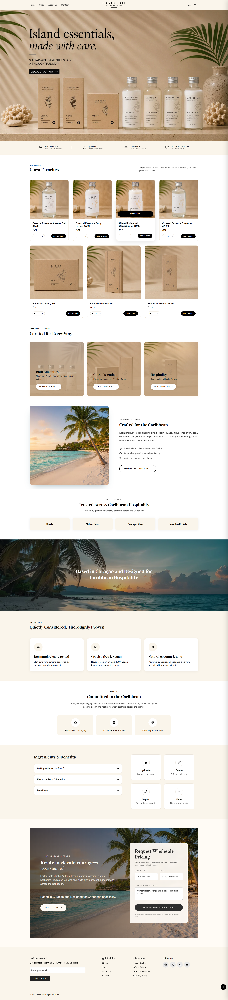
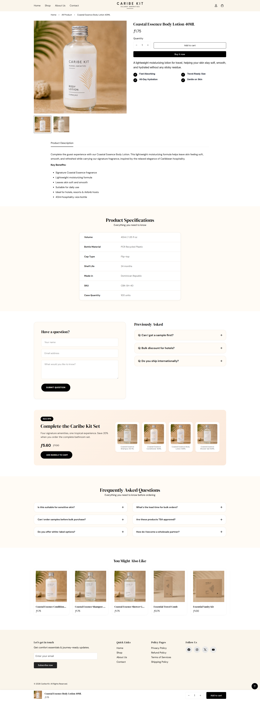
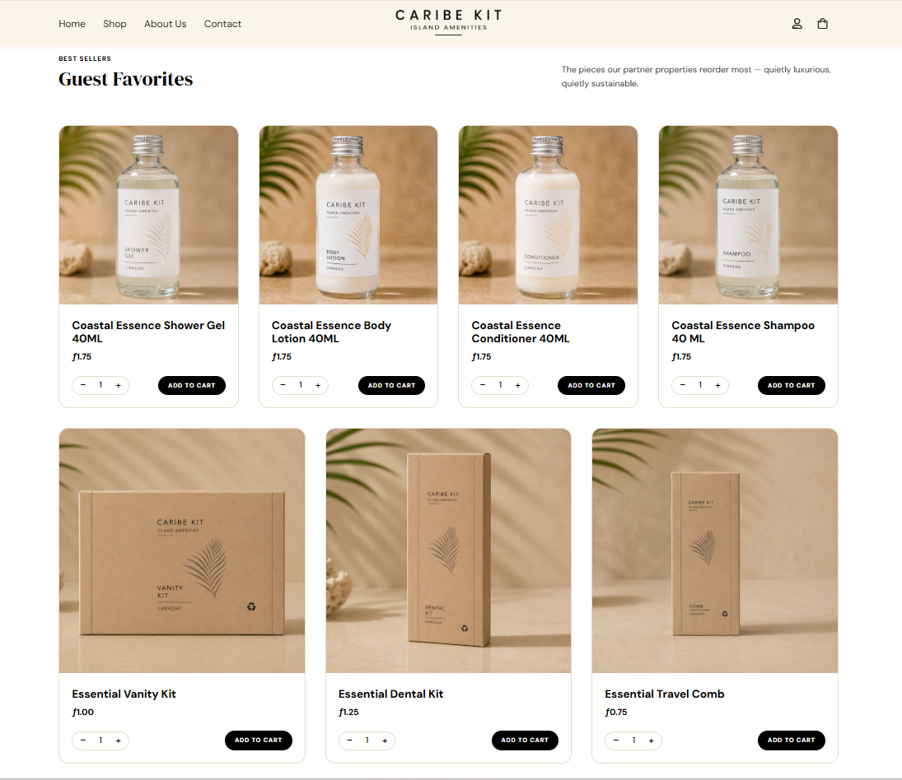
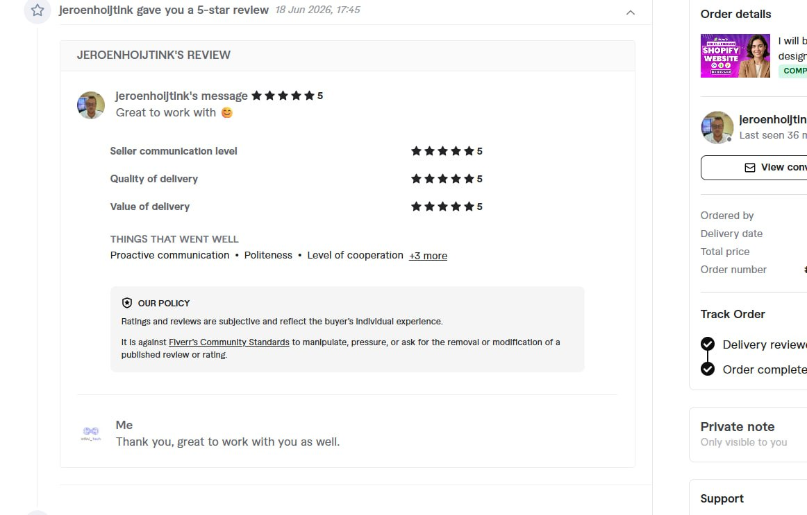

# CaribeKit — Premium Guest Amenities for Hotels, Resorts & Airbnbs

> **Live Website:** [https://caribekit.com/](https://caribekit.com/)

---

## 📌 Project Overview

**CaribeKit** is a Curaçao-based hospitality brand dedicated to elevating the guest experience across the Caribbean. The brand crafts sustainable, premium-quality toiletries and skincare essentials tailored specifically for **Hotels, Boutique Resorts, Airbnb Hosts, and Vacation Rentals**.

During my tenure at my previous agency, this client project was assigned to me. I served as the **Shopify Frontend Theme Developer**, responsible for building an elegant, high-converting B2B & DTC storefront powered by Shopify Online Store 2.0 standards.

---

## 🛠️ My Role & Responsibilities

As the dedicated theme developer for this project, my work included:

- **Shopify OS 2.0 Theme Development:** Architecting modular Liquid sections and dynamic JSON templates tailored for hospitality retail and wholesale inquiries.
- **Hospitality-Focused UX:** Developing custom segment blocks tailored for different accommodation providers (Hotels, Airbnb Hosts, Boutique Stays, Vacation Rentals).
- **Product Landing Architecture:** Creating rich product showcases (e.g., Hydrating Body Lotion 40ml) highlighting key benefits: dermatologically tested, non-greasy, tropical island-inspired, and eco-friendly.
- **B2B Bulk & Sample Request Flow:** Implementing intuitive call-to-actions, inquiry triggers, and wholesale account integration.
- **Mobile-First Responsiveness:** Ensuring fluid performance and clean typography across mobile devices, tablets, and desktops.
- **Locales & Internationalization:** Setting up flexible schema controls (settings_schema.json) and language locales for seamless merchant management.

---

## 💻 Tech Stack

- **Platform:** Shopify Online Store 2.0
- **Templating:** Liquid, JSON Templates
- **Frontend:** HTML5, CSS3 / Custom SCSS, JavaScript (ES6+)
- **Architecture:** Modular Shopify Sections & Blocks
- **Tools:** Shopify Theme Architecture, Git

---

## 📂 Theme Structure

\\\	ext
├── assets/         # CSS styles, JS modules, brand fonts and SVG assets
├── config/         # Theme settings schema and default presets
├── layout/         # Base layout wrappers (theme.liquid, password.liquid)
├── locales/        # Internationalization and language strings
├── sections/       # Modular section components (hero, guest favorites, trust badges)
├── snippets/       # Reusable Liquid snippets (cards, icons, form helpers)
├── templates/      # JSON templates for products, collections, pages, and blogs
└── screenshots/    # High-resolution storefront previews
\\\

---

## 📸 Storefront Previews

| Homepage & Guest Favorites | Hydrating Body Lotion (Product View) |
| :---: | :---: |
|  |  |

| Store Preview & Grid | Caribbean Hospitality Brand Visual |
| :---: | :---: |
|  |  |

---

## ⚖️ Disclaimer

All brand assets, copy, imagery, and trademarks belong to **CaribeKit** ([caribekit.com](https://caribekit.com)). This repository is presented solely to showcase my individual frontend development contributions, custom Liquid theme engineering, and technical implementation completed for the client.

<!-- Verified production build for CaribeKit -->
